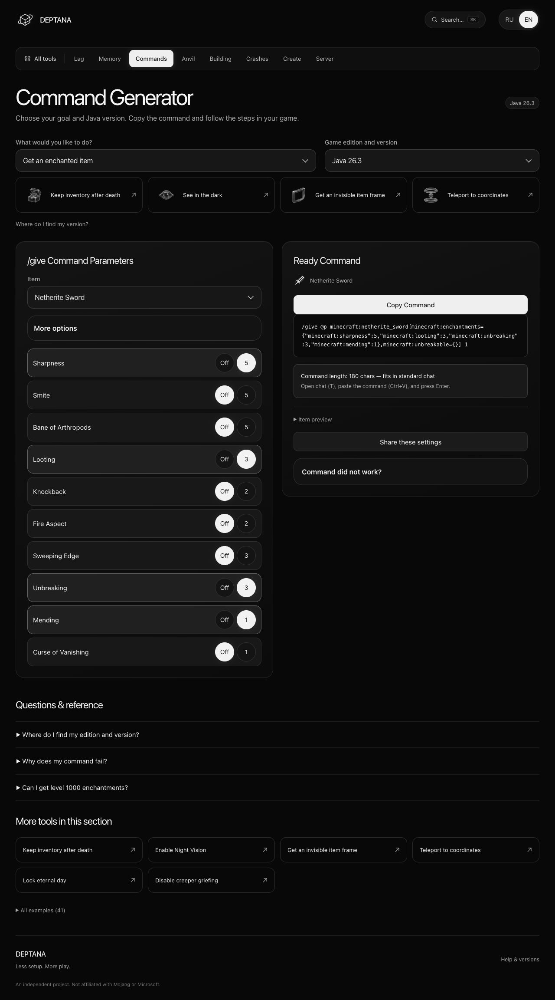

# DEPTANA — Minecraft Java tools

[Открыть на русском](https://deptana.ru/ru?utm_source=github&utm_medium=referral&utm_campaign=project_readme) · [Open in English](https://deptana.ru/en?utm_source=github&utm_medium=referral&utm_campaign=project_readme) · [Русская инструкция](README.ru.md)

DEPTANA is a collection of free browser tools for Minecraft Java Edition. Generate a command for your game version, plan enchantments on an anvil, or inspect a performance report.

This repository contains user guides and a public issue tracker. The website's application source is not included here.

## Choose a task

| I want to… | Open |
| --- | --- |
| Give an enchanted item or set an effect's duration | [Command generator](https://deptana.ru/en/command-generator?utm_source=github&utm_medium=referral&utm_campaign=project_readme) |
| Work out an anvil combination order | [Anvil calculator](https://deptana.ru/en/anvil-calculator?utm_source=github&utm_medium=referral&utm_campaign=project_readme) |
| Read an F3 + L performance report | [Lag analyzer](https://deptana.ru/en/minecraft-lag-analyzer?utm_source=github&utm_medium=referral&utm_campaign=project_readme) |
| Check a crash log for known error signatures | [Crash-log analyzer](https://deptana.ru/en/crash-log-analyzer?utm_source=github&utm_medium=referral&utm_campaign=project_readme) |
| Follow a block layout for a circle or sphere | [Building tools](https://deptana.ru/en/minecraft-circle-generator?utm_source=github&utm_medium=referral&utm_campaign=project_readme) |

No website account is needed. The interactive tools require JavaScript. Russian and English interfaces are available.

## Generate your first command

1. Open the command generator and select the task.
2. Select your Minecraft Java version. The site's version list is the supported list; do not assume the output works in another release or in Bedrock.
3. Adjust the item, enchantments or effect duration.
4. Copy the command. In your own world, enable commands, open chat with T and paste it. On a server you need the appropriate permissions.

If it fails, use “Command did not work?” below the result. A syntax error, a chat length limit and a missing permission need different fixes.

## Read a lag report

In a Minecraft Java world, press F3 + L and keep playing through the slowdown during the recording. After about 10 seconds, find the ZIP in the game profile's `debug/profiling` folder and open it in the lag analyzer. Some keyboards need Fn as well.

The analyzer reads the report in your browser. It shows measurements that the file contains and suggests checks. It cannot prove the cause of every FPS drop. A large profiler branch is a clue, and missing measurements are not zeroes. Change one setting and record again to compare the same scene.

Do not confuse a performance ZIP with a crash log. Use the crash-log analyzer for a file from `crash-reports` or `logs/latest.log`. An exit code on its own rarely identifies the cause.

## Report a problem

[Open an issue](https://github.com/Deptana/minecraft-tools/issues/new) in Russian or English. Include the tool URL, game edition and exact version, browser, steps to reproduce, expected result and actual result. For a command problem, include the generated command and the game's exact error message.

Please remove personal information from screenshots and excerpts. Do not post full private logs, server IPs, access tokens or account details. See [the reporting guide](CONTRIBUTING.md).

DEPTANA is an independent project, not affiliated with Mojang or Microsoft.
